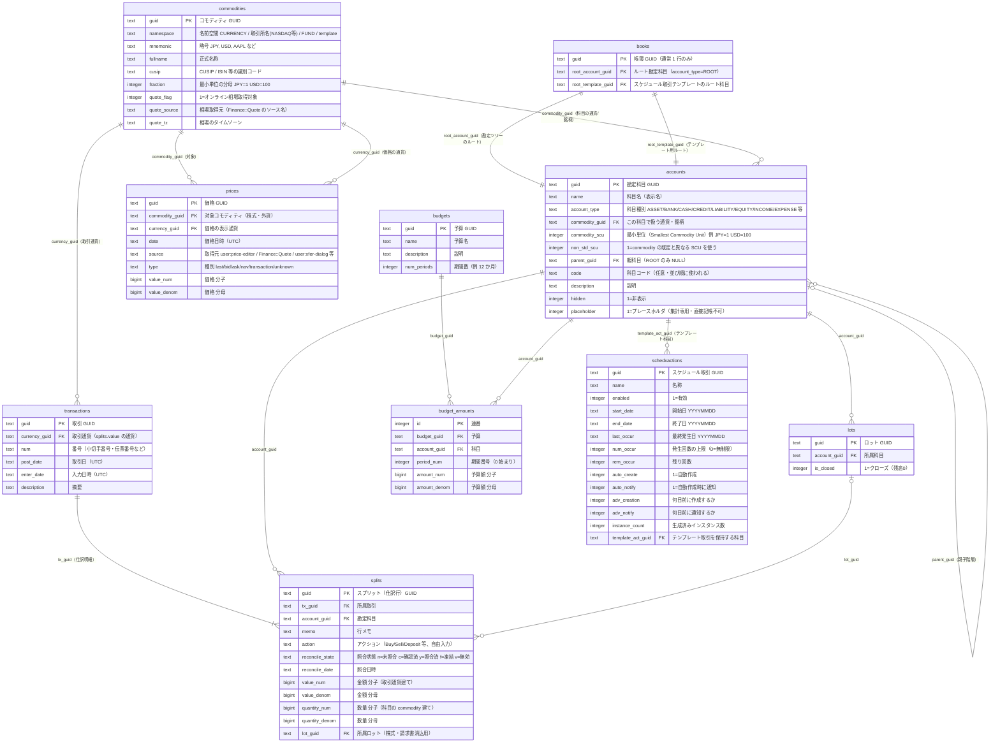
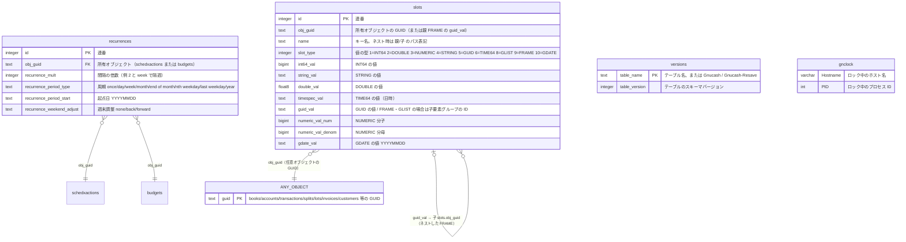
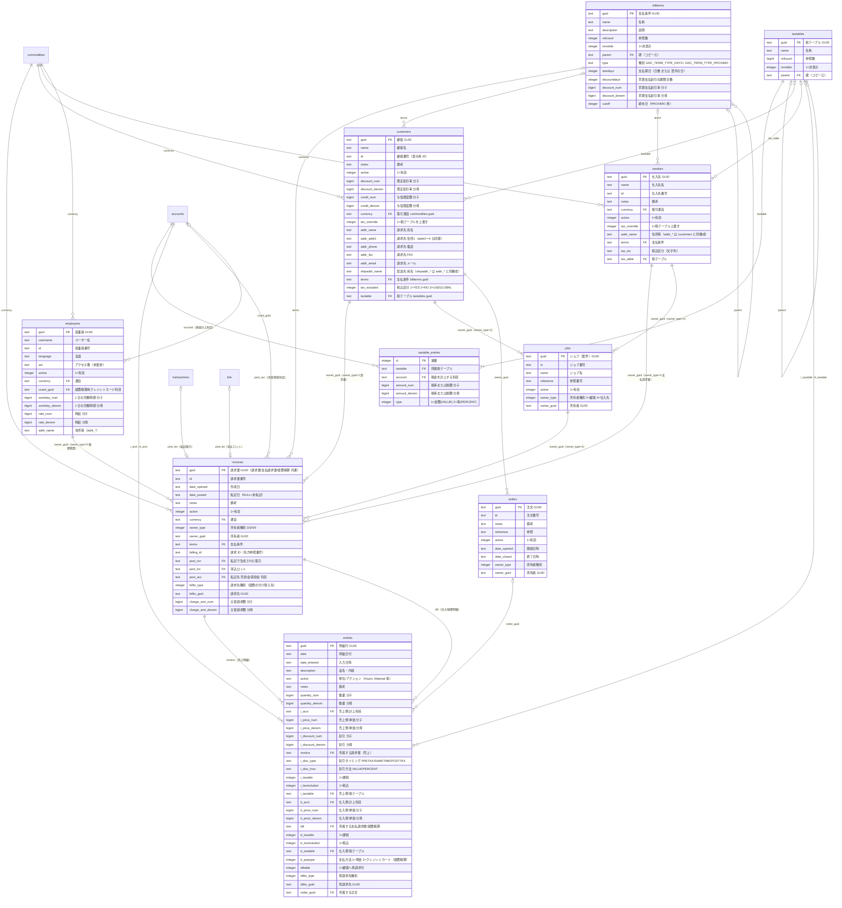

# GnuCash SQLite DB スキーマ

対象ファイル: `gnucash.gnucash`（SQLite 3 / GnuCash 2.6 系で作成 → 新しい版で再保存）
参照: [gnucash/gnucash](https://github.com/gnucash/gnucash) の `libgnucash/backend/sql/` 配下（`gnc-account-sql.cpp`, `gnc-transaction-sql.cpp`, `gnc-slots-sql.cpp`, `gnc-invoice-sql.cpp` など）

---

## 0. 全体を読むための前提知識

| 項目 | 内容 |
|---|---|
| **外部キー制約なし** | DDL 上は FK も多くの INDEX も定義されていない。関連はすべて GnuCash 本体（C++）側の論理的な参照。Web 版では JOIN 時に孤立データがあり得る前提で実装すること。 |
| **GUID** | 主キーは 32 桁の 16 進文字列（ハイフンなし UUID）。新規作成時は `uuid4().hex` 相当で生成する。 |
| **金額 = 有理数** | 金額・数量はすべて `*_num`（分子）/ `*_denom`（分母）の 2 カラム。実値 = `num / denom`。浮動小数点で保存しないこと。JPY なら通常 `denom = 1`、USD なら `100`。 |
| **日時** | `text(19)` で UTC 保存。**このファイルでは 2 形式が混在**：古い行は `YYYYMMDDHHMMSS`（14 桁, 12,810 件）、新しい行は `YYYY-MM-DD HH:MM:SS`（19 桁, 10,542 件）。`books` の slot `features/ISO-8601 formatted date strings...` が立っていると以降の書き込みは ISO 形式。読み込みは両対応必須。 |
| **日付のみ** | `text(8)` は `YYYYMMDD`（スケジュール取引・recurrence 等）。 |
| **post_date の時刻** | GnuCash 3.x 以降は取引日を「その日の 10:59:00 UTC」で保存する（タイムゾーンずれ対策）。古いデータは `ローカル 00:00 → UTC`（例: JST なら前日 15:00:00）。日付表示はタイムゾーン変換後に日付部分を使う。 |
| **真偽値** | `integer` の 0 / 1。 |
| **排他ロック** | `gnclock` に行がある間はデスクトップ版が開いている。Web 版で書き込む場合は尊重すべき。 |
| **拡張属性 (KVP)** | テーブルに無い属性は `slots` に Key-Value で格納（備考・勘定科目の色・請求書関連付けなど）。 |

### このファイルの実データ件数

| テーブル | 件数 | テーブル | 件数 |
|---|---:|---|---:|
| accounts | 330 | splits | 49,598 |
| transactions | 23,352 | slots | 20,586 |
| commodities | 2（JPY, template） | books | 1 |
| その他（budgets, prices, lots, schedxactions, ビジネス系） | 0 | | |

→ 当面の Web 版は **会計コア（books / accounts / commodities / transactions / splits / slots）** の実装が中心になる。

---

## 1. ER 図（会計コア）

### 複式簿記の核：transactions ↔ splits

- 1 件の **transaction（取引）** は 2 件以上の **split（仕訳行）** を持つ。
- 1 取引内の `value` の合計は **必ず 0**（借方 = 正、貸方 = 負）。
- `value` は取引通貨（`transactions.currency_guid`）建て、`quantity` は科目の通貨（`accounts.commodity_guid`）建て。同一通貨なら両者は同じ値。外貨や株式では `quantity / value` が為替レート・単価になる。
- 科目残高 = その科目の `splits.quantity` の合計。

**符号の慣例（GnuCash 内部値）**

| 科目種別 | 増加時の split 値 | 画面表示 |
|---|---|---|
| ASSET / BANK / CASH / STOCK / MUTUAL / RECEIVABLE / EXPENSE | 正（借方） | そのまま |
| LIABILITY / CREDIT / PAYABLE / EQUITY / INCOME | 負（貸方） | 通常は符号反転して表示（設定「残高の符号を反転」） |

**account_type 一覧**（`Account.h` の `GNCAccountType`）

| 値 | 意味 | 本ファイル件数 |
|---|---|---:|
| ROOT | ルート（不可視） | 2（通常＋テンプレート） |
| BANK | 銀行口座 | 19 |
| CASH | 現金 | 46 |
| ASSET | 資産 | 90 |
| CREDIT | クレジットカード | 39 |
| LIABILITY | 負債 | 9 |
| STOCK / MUTUAL | 株式 / 投資信託 | 0 |
| CURRENCY | 通貨取引（旧式） | 0 |
| INCOME | 収益 | 21 |
| EXPENSE | 費用 | 100 |
| EQUITY | 資本（純資産） | 2 |
| RECEIVABLE / PAYABLE | 売掛金 / 買掛金（ビジネス機能） | 2 / 0 |
| TRADING | 通貨売買勘定（トレーディング勘定） | 0 |

> 注: `books.root_template_guid` 配下の科目（commodity は `namespace=template`）はスケジュール取引のテンプレート用。通常の科目ツリー表示からは除外する。

---

## 2. ER 図（拡張属性・繰り返し・メタ情報）

### slots（KVP）の読み方

- `slot_type = 9 (FRAME)` の行は「フォルダ」。その `guid_val` を `obj_guid` に持つ行が子要素。`name` は `親/子` のフルパスで保存される。
  - 例（本ファイル）: `reconcile-info`(FRAME, guid_val=d8db…) → 子 `reconcile-info/last-date`, `reconcile-info/include-children`
- **本ファイルで使われているキー**

| name | 型 | 所有者 | 意味 |
|---|---|---|---|
| `date-posted` | GDATE | transactions | 取引日（日付のみ）。post_date のタイムゾーン問題回避用。20,537 件 |
| `notes` | STRING | transactions | 取引の備考（2 行目メモ） |
| `placeholder` | STRING | accounts | `"true"` で placeholder（旧形式の名残） |
| `balance-limit` | FRAME | accounts | 残高上限/下限アラート設定 |
| `reconcile-info/*` | FRAME/INT64 | accounts | 最終照合日・子科目を含めるか |
| `trans-txn-type` | STRING | transactions | 取引種別 `I`=請求書 `P`=支払 等 |
| `last-num` | STRING | accounts | 最後に使った伝票番号 |
| `features/*` | STRING | books | ファイルが要求する機能フラグ（古い GnuCash で開けなくする） |

- その他よく使われるキー: `color`（科目色）, `tax-related`, `equity-type`（期首残高科目）, `void-reason` / `void-time` / `void-former-amount`（取消取引）, `gncInvoice/invoice-guid`（取引⇔請求書）, `gncOwner/*`（ロットの取引先）, `title`（ロット名）, `assoc_uri`（添付リンク）, `options/*`（帳簿オプション）。

---

## 3. ER 図（ビジネス機能：請求書・取引先）

> 本ファイルでは全テーブル 0 件。将来対応用。
> `owner_type` / `billto_type` は `gncOwner.h` の `GncOwnerType`：0=NONE 1=UNDEFINED 2=CUSTOMER 3=JOB 4=VENDOR 5=EMPLOYEE。`owner_guid` はその種別に応じたテーブルを指す**ポリモーフィック参照**。

---

## 4. テーブル一覧（日本語サマリ）

| テーブル | 日本語名 | 役割 | versions |
|---|---|---|---:|
| `versions` | バージョン管理 | 各テーブルのスキーマ版と GnuCash 本体の版（`Gnucash`=2060000 → 2.6.0 系で作成） | – |
| `gnclock` | ロック | 同時オープン防止 | – |
| `books` | 帳簿 | ファイル全体のルート。科目ツリーとテンプレートツリーの起点 | 1 |
| `accounts` | 勘定科目 | 科目ツリー（`parent_guid` による隣接リスト） | 1 |
| `commodities` | 通貨・銘柄 | 通貨、株式、投資信託など | 1 |
| `transactions` | 取引 | 仕訳のヘッダ（日付・摘要・通貨） | 4 |
| `splits` | 仕訳明細 | 取引の各行（科目・金額・数量・照合状態） | 5 |
| `lots` | ロット | 株式の取得単位、請求書と支払の消込単位 | 2 |
| `prices` | 価格 | 株価・為替レートの履歴（Price DB） | 3 |
| `budgets` | 予算 | 予算のヘッダ | 1 |
| `budget_amounts` | 予算額 | 予算 × 科目 × 期間の金額 | 1 |
| `schedxactions` | スケジュール取引 | 定期取引の設定 | 1 |
| `recurrences` | 繰り返し規則 | スケジュール取引・予算の周期 | 2 |
| `slots` | 拡張属性 (KVP) | 任意オブジェクトの追加属性 | 4 |
| `customers` | 顧客 | ビジネス機能 | 2 |
| `vendors` | 仕入先 | ビジネス機能 | 1 |
| `employees` | 従業員 | ビジネス機能（経費精算） | 2 |
| `jobs` | ジョブ（案件） | 顧客/仕入先に紐づく案件 | 1 |
| `orders` | 注文 | ビジネス機能 | 1 |
| `invoices` | 請求書 | 請求書・支払請求書・経費精算書 共通 | 4 |
| `entries` | 請求明細 | 請求書の各行 | 4 |
| `billterms` | 支払条件 | 支払期日・早期割引 | 2 |
| `taxtables` | 税テーブル | 消費税等の定義 | 2 |
| `taxtable_entries` | 税テーブル明細 | 税率と計上科目 | 3 |

---

## 5. Web 版実装時の注意点

1. **金額は Decimal / 有理数で扱う**（JS なら `BigInt` で num/denom を保持、または decimal ライブラリ）。表示は `commodities.fraction` で丸める。
2. **日付パースは 2 形式対応**（`YYYYMMDDHHMMSS` と `YYYY-MM-DD HH:MM:SS`）。書き込み時は `books` の `features` slot に ISO-8601 フラグがあれば ISO 形式で書く。
3. **取引の保存は splits の value 合計 = 0 を検証**してから、トランザクション（DB の BEGIN/COMMIT）で transactions・splits・slots をまとめて書く。
4. **取引日を変更したら `slots.date-posted`（GDATE）も更新**する。
5. 科目ツリーは `WITH RECURSIVE` で `books.root_account_guid` から辿る。テンプレート側ツリーは除外。
6. 残高計算は `splits.quantity_num / quantity_denom` を科目ごとに SUM（既存 INDEX `splits_account_guid_index` が効く）。日付で絞る場合は `transactions.post_date` と JOIN。
7. 書き込み時は `gnclock` を確認し、デスクトップ版が開いている間は読み取り専用にするのが安全。
8. 未知の slot は消さずに保持する（デスクトップ版の機能が壊れるため）。
